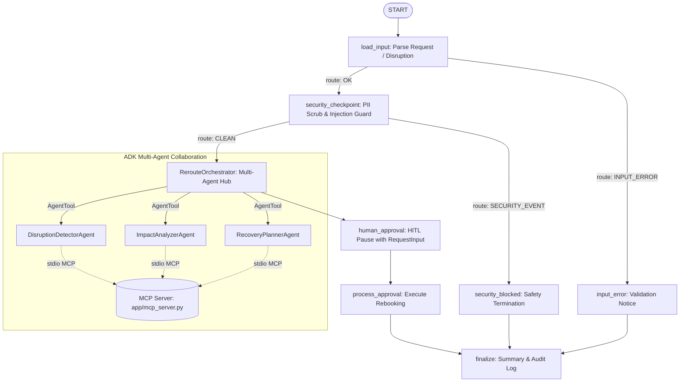

# ✈️ RerouteAI — Project Submission & Architecture Write-Up

**Track:** Concierge Agents / Freestyle  
**Agent Name:** `RerouteAI`  
**Framework:** Google ADK 2.11 & Gemini 2.5 Flash  

---

## 1. Problem Statement

Modern travel is deeply interconnected: a traveler rarely books a standalone flight. A typical journey involves a tightly coupled multi-modal chain:
`Flight` ➔ `Airport Cab / Transit` ➔ `Hotel / Resort Check-in` ➔ `Connecting Train / Bus`.

When a 4-hour flight delay or cancellation strikes (e.g. IndiGo BLR ➔ IXE delayed due to weather or technical reasons):
1. **The Ripple Effect**: Airlines only notify you about the flight; they do not adjust your pre-paid airport taxi, notify your hotel that you will miss standard check-in, or re-route your subsequent train.
2. **Cognitive Overload**: The passenger is left stranded at an airport terminal frantically opening 4 different apps (airline, Uber/Ola, MakeMyTrip, IRCTC), recalculating arrival times against personal constraints (e.g., reaching before nightfall, staying within budget).
3. **Sub-optimal Choices**: Without holistic real-time alternative modeling, travelers either overspend on last-minute flights or pick options that break their downstream itinerary.

**RerouteAI** solves this by acting as an autonomous, multi-agent recovery concierge. It detects disruptions, maps downstream cascading dependencies, generates 4 mathematically ranked recovery alternatives, and executes rebooking with the passenger's informed consent.

---

## 2. Solution Architecture

RerouteAI uses a declarative **ADK 2.11 Workflow Graph** coordinating specialized LLM agents and a local MCP tool server:

---

## 3. Core Concepts & Implementation References

| ADK & AI Concept | Implementation Details | File Reference |
| :--- | :--- | :--- |
| **ADK 2.0+ Workflow Graph** | Declarative graph topology (`Workflow(edges=[...])`) with `FunctionNode`, `Edge(route=...)`, conditional branch routing, and barrier convergence. | [`app/agent.py`](file:///c:/Users/shett/OneDrive/Documents/RerouteAI/reroute-ai/app/agent.py#L380-L425) |
| **Specialized Sub-Agents** | Three single-responsibility `LlmAgent` instances: `DisruptionDetectorAgent`, `ImpactAnalyzerAgent`, and `RecoveryPlannerAgent` using `gemini-2.5-flash`. | [`app/agent.py`](file:///c:/Users/shett/OneDrive/Documents/RerouteAI/reroute-ai/app/agent.py#L40-L135) |
| **AgentTool Delegation** | Orchestrator delegates tasks to specialized sub-agents via `agent_tool.AgentTool`, synthesizing their JSON outputs. | [`app/agent.py`](file:///c:/Users/shett/OneDrive/Documents/RerouteAI/reroute-ai/app/agent.py#L140-L168) |
| **Model Context Protocol (MCP)** | Stdio-based FastMCP server exposing 5 domain tools (`get_booking_details`, `get_itinerary`, `search_alternatives`, `confirm_rebooking`, `get_audit_log`). | [`app/mcp_server.py`](file:///c:/Users/shett/OneDrive/Documents/RerouteAI/reroute-ai/app/mcp_server.py#L205-L350) |
| **McpToolset Integration** | `McpToolset` connected to `app.mcp_server` via `StdioConnectionParams(server_params=StdioServerParameters(...))`. | [`app/agent.py`](file:///c:/Users/shett/OneDrive/Documents/RerouteAI/reroute-ai/app/agent.py#L25-L35) |
| **Security Checkpoint Node** | Regex PII redactor (Aadhaar, PAN, phone, cards), keyword prompt injection detector, and budget sanity filter. | [`app/agent.py`](file:///c:/Users/shett/OneDrive/Documents/RerouteAI/reroute-ai/app/agent.py#L200-L290) |
| **Human-in-the-Loop (HITL)** | Pauses workflow execution using ADK's `RequestInput` and resumes with `ctx.resume_inputs`. | [`app/agent.py`](file:///c:/Users/shett/OneDrive/Documents/RerouteAI/reroute-ai/app/agent.py#L310-L345) |

---

## 4. Security Design

The travel domain involves high-risk sensitive data: government identity documents, payment records, and financial transaction limits.

1. **PII Redaction Engine**:
   - Scrubs Indian Aadhaar numbers (`\b\d{4}\s?\d{4}\s?\d{4}\b`), PAN cards (`[A-Z]{5}[0-9]{4}[A-Z]`), Indian mobile numbers (`(?:\+91|0)?[6-9]\d{9}`), passports, emails, and credit cards before prompt synthesis.
   - Replaces matches with `[REDACTED_<TYPE>]` to protect traveller privacy from LLM context leakage.
2. **Prompt Injection Mitigation**:
   - Inspects raw payload text against systemic jailbreak heuristics (`"ignore previous instructions"`, `"override system"`, `"developer mode"`, etc.).
   - Triggers immediate termination along the `SECURITY_EVENT` edge to `security_blocked`, preventing malicious prompts from reaching the model.
3. **Domain Constraint Auditing**:
   - Enforces non-negative numerical budget rules (`max_extra_budget_inr >= 0`).
   - Generates an immutable structured JSON audit record attached to `ctx.state["security_audit"]` tracking timestamp, checks executed, and severity level.

---

## 5. MCP Server Design

The MCP server (`app/mcp_server.py`) operates over `stdio` transport, adhering to the Model Context Protocol standard:

1. `get_booking_details(booking_id: str)`: Fetches flight/train/cab/hotel booking metadata, departure/arrival timestamps, pricing, and dependency IDs.
2. `get_itinerary()`: Returns the traveler's complete ordered itinerary chain (`BK001` flight ➔ `BK002` cab ➔ `BK003` resort ➔ `BK004` return train).
3. `search_alternatives(booking_id: str, disruption_type: str)`: Searches multi-modal inventory for Karnataka corridors (Air India, IndiGo, Konkan Kanya Express, Mangaluru Express, KSRTC Volvo AC buses, Rapido outstation cabs, Manipal Residency hotel rooms).
4. `confirm_rebooking(original_booking_id: str, new_option_id: str)`: Simulates booking amendment and returns an updated confirmation reference.
5. `get_audit_log()`: Exposes transaction log of all rebooking actions taken during the session.

---

## 6. Human-in-the-Loop (HITL) Workflow

Autonomous financial transactions without human consent are dangerous in travel bookings. 

- After the `RerouteOrchestrator` compiles the 4 ranked recovery plans (`FASTEST`, `CHEAPEST`, `MOST_COMFORTABLE`, `AI_RECOMMENDED`), control transitions to `human_approval`.
- The node yields a `RequestInput` interrupt with a formatted plan summary.
- The workflow enters a non-blocking paused state in the ADK session.
- Once the traveler inputs their choice (e.g. `AI_RECOMMENDED` or `REJECT`), the workflow resumes with `rerun_on_resume=True`, reads `ctx.resume_inputs["traveller_approval"]`, and executes `process_approval`.

---

## 7. Demo Walkthrough

### Scenario: Bengaluru (BLR) to Mangaluru (IXE) IndiGo Flight Delay
- **Disruption**: IndiGo 6E-501 (BK001) scheduled at 06:30 is delayed by 240 minutes (4 hours), pushing arrival from 08:10 to 12:10.
- **Cascading Impact Detected**:
  - `BK002` (Ola Outstation Cab from IXE to Udupi pickup at 08:40): **Missed connection** (4 hours late).
  - `BK003` (Ideal Beach Resort check-in at 12:00): **Delayed arrival**.
- **Generated Recovery Options**:
  1. ⚡ **FASTEST**: Air India AI-485 at 10:15 (Arrives 11:55, extra cost 900 INR). Reschedules cab to 12:15.
  2. 💰 **CHEAPEST**: IndiGo 6E-543 at 13:45 (Arrives 15:25, free airline rebooking, 0 INR extra).
  3. 🛋️ **MOST_COMFORTABLE**: Konkan Kanya Express AC Chair / First Class (Comfort score 8/10, avoids flight delay fatigue).
  4. 🌟 **AI_RECOMMENDED**: Air India AI-485 (Minimizes resort vacation day loss, within the 5,000 INR budget).
- **Resolution**: Traveler approves `AI_RECOMMENDED`; rebooking confirmed and audit log finalized.

---

## 8. Value & Impact

- **For Travellers**: Eliminates anxiety, saves hours of chaotic manual re-planning, and protects against missed non-refundable hotel stays or connecting travel.
- **For Travel Operators & Concierges**: Provides an enterprise-ready, auditable multi-agent workflow that reduces support ticket volume while maintaining safety and human agency.
